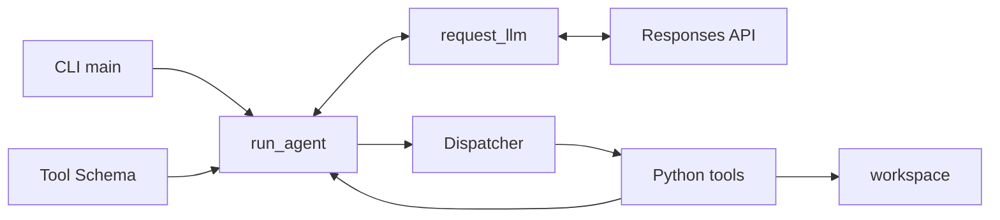

# Mini Agent CLI v0.1

从零实现的 Python 命令行 Agent Runtime，用于学习模型工具调用、执行循环和工程可靠性。它可以读取受限工作区内的文本、计算、创建结果文件，并把工具执行结果交回模型继续处理。

这是 Week 1 学习项目的交付版本，尚不是具备持久化、权限审批和故障恢复的产品。版本名称不代表已经创建 Git tag 或 GitHub Release。

## 核心功能

- OpenAI Responses API 与手写多轮 Agent Loop。
- JSON Schema 工具声明、参数校验和 Dispatcher 路由。
- `calculate`：加、减、乘、除。
- `read_file`、`write_file`、`search_files`：受限目录内的文本操作。
- Runtime 状态、最大轮数、日志、逻辑 LLM 请求次数及耗时统计。
- 网络分阶段超时、有限重试、API 和工具异常处理。
- pytest 离线测试：Mock SDK、假 HTTP 传输、临时文件目录。

## 系统架构



模型提出工具调用，Runtime 决定是否执行，Dispatcher 校验并路由，工具函数执行实际操作。模型不会直接获得 Python 执行权限。

```text
mini-agent/
├── agent_loop.py           # Runtime、结果类型、CLI 入口
├── llm_client.py           # API 异常分类、超时和重试
├── tool_schema.py          # 对模型公开的工具契约
├── tool_dispatcher.py      # 工具白名单与参数校验
├── tool_impl.py            # 计算、文件操作与路径检查
├── requirements.txt       # 运行依赖
├── requirements-dev.txt   # 运行依赖 + pytest
├── pytest.ini
├── tests/                 # 离线测试及共享 fixture
├── docs/                  # 架构、本周总结、Day 5 学习记录
└── workspace/             # 本地用户数据，不进入 Git
```

详细设计见 [架构说明](docs/architecture.md)，验收与后续研究见 [Week 1 总结](docs/week1_review.md)。

## 环境要求

- 源码使用 `StrEnum`，要求 Python 3.11+；实际验收环境为 Windows、Python 3.12.3，其他版本尚未验证。
- 安装依赖需要包下载源；真实 Agent 运行需要网络和具有目标模型访问权限的 API Key。
- 自动化测试运行不需要真实 API Key 或网络。
- 当前模型常量在 `agent_loop.py` 中为 `gpt-6-luna`，这是项目配置值，不保证所有账户可用；本次未验证线上模型可用性。

## Windows PowerShell 安装

```powershell
Set-Location 'D:\ai agent\mini-agent'
py -3.12 -m venv .venv
.\.venv\Scripts\Activate.ps1
python -m pip install -r requirements-dev.txt
```

已有 `.venv` 时跳过创建步骤。仅运行 Agent 可安装 `requirements.txt`；开发和验收安装 `requirements-dev.txt`。

如果 PowerShell 阻止激活脚本，无需修改执行策略，直接使用虚拟环境解释器：

```powershell
.\.venv\Scripts\python.exe -m pip install -r requirements-dev.txt
.\.venv\Scripts\python.exe -m pip check
```

运行依赖保留当前固定版本；未在全新环境重新下载安装验证。`pip check` 通过表示当前环境依赖关系一致，不等于所有平台均可安装。

## API Key 配置

在根目录的本地 `.env` 中填写以下变量。下面只有占位符；已有文件只修改所需字段，不要覆盖其他配置。

```dotenv
OPENAI_API_KEY=your_api_key_here
```

`.env` 与其本地变体已忽略。不要提交密钥或复制到日志。导入 Runtime 不加载 `.env`，只有 CLI 的 `main()` 会加载。

## 运行 Agent

默认任务读取 `workspace/report.txt`、累计支出，然后尝试新建 `workspace/summary_day5_api_test.txt`。这是固定示例任务，目前没有交互式命令行参数解析。

如果 `workspace` 不存在，请创建目录；如果 `report.txt` 不存在，可新建 UTF-8 文本，例如三行 `100`、`200`、`50`。不要覆盖已有业务数据。

```powershell
python agent_loop.py
# 未激活虚拟环境时：
.\.venv\Scripts\python.exe agent_loop.py
```

真实运行会调用 API，输出最终回答、状态、轮数、工具错误数量以及耗时。输出文件已存在时工具拒绝覆盖；重复演示前请根据业务意图更换任务中的输出文件名。

其他模块可调用 `run_agent(client, prompt, max_steps=12, max_attempts=3)`。调用者负责创建和关闭客户端，并将 SDK `max_retries` 设为 `0`，避免重复重试。详见架构文档。

## 自动化测试

激活虚拟环境后运行：

```powershell
python -m pytest -q
```

不激活时使用 `.\.venv\Scripts\python.exe -m pytest -q`。pytest 发现 `tests/test_*.py`，同时运行已有 `unittest.TestCase`。不要仅用 unittest 命令验收，它不会执行新增的 pytest 函数测试。

`conftest.py` 为每项测试提供临时工作区、移除当前进程中的 API Key，并阻止 `.env` 加载及常见 socket 网络路径。Mock 提供响应与异常；HTTP 集成测试使用假传输层。fixture 在测试执行阶段生效，不是整个进程或子进程的操作系统沙箱。

2026-11-15 实测：100 个测试项，99 通过、0 失败、1 跳过；另有 54 个 unittest 子场景通过。跳过原因是当前 Windows 缺少创建符号链接权限。没有测量覆盖率百分比，没有通过真实 API 制造故障。

## 文件工具的安全限制

- 根目录为源码目录下的 `workspace/`；拒绝绝对路径及解析后逃出根目录的路径，包括静态外部符号链接目标。
- 读写仅允许 `.txt`（扩展名检查不区分大小写），按 UTF-8 处理。
- 写入仅允许新建文件（`open("x")`），不覆盖，父目录必须存在；上限为 UTF-8 编码后 16 KiB。
- 搜索递归扫描 `*.txt`，跳过大于 16 KiB 的文件与目录外目标；最多 20 个命中，每个返回行最多 200 字符。关键词用 `casefold()` 比较；文件名 glob 的大小写行为依赖平台。
- `read_file` 尚无大小上限；搜索遇到解码或权限错误可能使整个工具调用失败。
- 文件内容会作为工具结果发送给模型 API。只应放入允许模型处理的数据。
- 尚无抵抗路径检查与打开之间并发替换的完整防护；这不是操作系统级沙箱，也没有用户审批流程。

## 已知限制

- `completed` 只表示对话结束，不证明业务目标成功；工具出错后模型给出最终答复仍可进入该状态。
- 最多处理 12 个模型响应，最后一轮可接收最终答案，但不会执行需要下一轮反馈的新工具；单轮工具数量无限额。
- 首轮 `tool_choice="required"`，之后为 `auto`，默认流程要求先调用工具。
- 连接/读取/写入/连接池超时为 5/30/10/5 秒，均非任务总截止时间；工具无独立超时或取消机制。
- Runtime 默认每个逻辑请求最多 3 次尝试；超时、断连、429 重试，退避 1、2 秒（更多尝试时上限 8 秒）。认证失败、其他状态错误（含 5xx）及其他 APIError 停止。没有 Retry-After、jitter 或配额类 429 分类。
- 客户端初始化错误、非 SDK 编程错误及工具返回值的 JSON 序列化异常不保证转成 Runtime 状态；计算未限制非有限数值。
- 模型、工具注册表和工作目录含全局配置；未验证多用户并发。没有持久化、恢复、审计事件流、token/费用统计或稳定 CLI 失败退出码。

## 后续方向（尚未实现）

优先引入每次运行独立的配置与工具上下文、结构化执行事件和总时间预算，再研究工具审批、幂等与失败恢复。CLI、GUI 和 FastAPI 应成为同一个 Runtime 的适配层；数据库保存任务历史与检查点。本次不增加 GUI、数据库、LangGraph 或 MCP。
