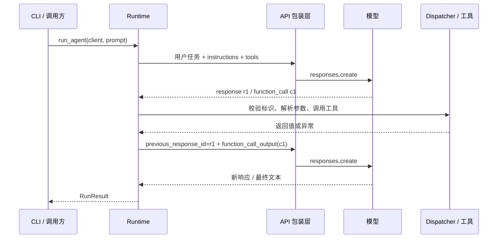

# Mini Agent CLI v0.1 架构说明

本文以 Week 1 交付源码为准。标为“建议”的内容尚未实现。

## 1. 模块边界：谁决定，谁执行

| 模块 | 当前职责 | 分开的原因 |
|---|---|---|
| `agent_loop.py` | `run_agent` 调度、协议拼装、状态和统计；`main` 管理 CLI 生命周期 | 模型不可信，程序必须掌握终止与副作用边界 |
| `llm_client.py` | 请求、SDK 异常分类、有限重试、耗时 | 重试策略不应散落在工具与循环内 |
| `tool_schema.py` | 工具名、描述、JSON 参数约束 | 向模型描述能力，不执行能力 |
| `tool_dispatcher.py` | 白名单查找、参数键和类型验证、调用函数 | 将外部 JSON 转成受控 Python 调用 |
| `tool_impl.py` | 算术、文件 IO、工作区路径边界 | 安全规则应在真正发生副作用的位置落实 |
| `tests/` | 单元、组件及离线集成验证 | 外部服务不应决定本地回归结果 |

对 C++ 开发者而言，Schema 类似对外协议声明，Dispatcher 类似解码与路由层，工具实现类似具体服务函数。但 JSON Schema 不是编译器类型检查：即便模型声明采用 strict schema，应用仍应验证输入，不能用类型注解替代运行时检查。

目前 Schema、Dispatcher 的 required_args 以及实现签名存在重复维护。测试验证名称和必填字段的一致性，但不是完整 Schema 校验器；后续可统一工具注册信息，不需要现在引入大型框架。

## 2. 一轮执行如何推进



`function_call` 是模型提出的调用请求，包含工具名、JSON 字符串参数和 `call_id`；Runtime 校验响应结构后才执行工具。未知工具、参数不是字典、缺失参数等由 Dispatcher 拒绝。

`function_call_output` 是应用回交的结果，本项目把结果封装成 JSON 字符串：

```json
{"type":"function_call_output","call_id":"call-1","output":"{\"ok\":true,\"result\":3}"}
```

失败也通过相同通道返回，payload 为 `{"ok":false,"error":{"type":"ValueError","message":"..."}}`。因此模型有机会说明失败或尝试修正参数，而不是失去上下文。

两个 ID 的层次不同：

- `call_id` 对应一个工具调用，类似 RPC 请求关联 ID。同轮多个工具的结果必须各自保留对应 ID；不能用工具名称替代，因为同一工具可能调用多次。
- `previous_response_id` 指向上一个模型响应，让后续请求关联模型上下文。它不是某个工具的 ID，也不是本地持久化检查点。当前没有在服务端上下文失效后重建对话的实现。

首次请求 `tool_choice="required"`，随后 `auto`。请求设置 `parallel_tool_calls=False`，但 Runtime 仍能处理收到的同轮多个调用，按列表顺序执行。没有实现并行工具执行。

## 3. 状态、终止与计数

| 状态 | 触发条件 | 解释 |
|---|---|---|
| `running` | 初始化运行 | 中间状态 |
| `completed` | completed 响应中没有工具调用，且最终文本非空 | 对话终止，不代表业务成功 |
| `model_incomplete` | 响应状态非 completed、结构缺失、工具标识无效或最终答案空白 | 不执行当前响应中的工具 |
| `max_steps_exceeded` | 最后允许处理的响应仍要求工具 | 停止，避免无反馈地执行更多副作用 |
| `api_failed` | API 包装层返回 None | 不再执行后续工具 |

`max_steps` 指模型响应处理轮数，不是工具数量，也不是 HTTP 尝试次数。默认 12：第 12 个响应可以给最终答案；若要求新工具，则不执行。初次 API 就失败时 `step=0`，但 `llm_calls=1`。非法轮数在请求之前被拒绝。

`RunResult` 是冻结 dataclass，包含状态、轮数、逻辑请求次数、LLM/工具耗时、最终答案和工具错误数。每次运行重新初始化统计，没有跨调用累加。`llm_calls` 不含重试次数，LLM 耗时包含重试和等待；工具耗时不代表整个任务耗时。

一个工具失败后，模型可能回答“无法完成”，此时 `completed` 和 `tool_errors=1` 可以同时成立。未来应单独设计业务验收结果，不能简单用 `tool_errors==0` 推断成功，也不能因曾经有错就否认随后恢复成功。

## 4. 异常与资源生命周期

API 包装层只重试超时、连接失败和 429。Runtime 默认最多 3 次尝试，等待 1、2 秒；通用退避上限 8 秒。认证失败、其他 HTTP 状态（含 5xx）和其他 APIError 不重试。SDK 重试设为 0，避免两个重试层相乘。

网络超时为 connect/read/write/pool = 5/30/10/5 秒；它们不是整个任务总期限。非 SDK 编程错误继续抛出，防止把代码 bug 伪装成网络问题。

工具边界捕获 `Exception`，转成错误 payload 并记录日志，但不吞掉 `KeyboardInterrupt`、`SystemExit`。这种宽捕获能保护对话流程，也可能把工具 bug 当普通失败；未来应区分业务错误与内部错误，并为后者保留脱敏诊断。JSON 输出序列化在该 try 块之外，未来工具返回不支持的对象可能使运行退出。

`main()` 才加载 `.env`、配置日志、创建客户端，并在 finally 中关闭客户端；导入生产模块不会启动 Agent。直接调用 `run_agent` 时客户端由调用者持有和释放，类似 C++ 中明确资源所有权。客户端构造失败目前仍可能直接抛出；CLI 没有把失败状态稳定映射为非零退出码。

## 5. 文件安全边界

文件目标先经过 `resolve()`，再检查是否属于 `WORKSPACE`。这是解析后路径检查，优于对字符串做简单前缀比较；静态符号链接逃逸也会被拒绝。读取和写入只允许 `.txt`，写入通过独占创建阻止覆盖，且检查 UTF-8 字节数与父目录存在性。

搜索还限制文件大小、结果数量和返回行长度。直接读取没有大小上限，扫描文件数量没有预算；坏编码或权限错误可能使整个搜索失败。关键词大小写折叠与文件名 glob 的大小写规则是两个不同层次。

现有边界不覆盖：并发替换路径的 TOCTOU 竞态、硬链接隔离、操作系统级权限隔离、敏感内容分类、输出脱敏和用户审批。工具错误消息也可能携带本机路径。文件文本作为模型输入发送到远端；提示词中“文件内容是不可信数据”有帮助，但不是提示注入防护的充分条件。

符号链接测试在当前 Windows 环境因权限不足跳过，不能把该场景称为实测通过。没有修改系统权限来掩盖这一限制。

## 6. 可测试性与现有证据

`run_agent` 接收客户端，测试只替换 `responses.create`，其他调度逻辑仍真实执行。像 C++ 依赖注入一样，外部 IO 的可替换边界降低测试成本；目前不强制继承接口，只依赖对象提供所需方法。

- 单元测试：算术、分发校验、文件工具边界。
- 组件测试：模拟模型响应验证多轮协议、状态和调用次数。
- 离线集成测试：真实 SDK 配合 MockTransport；真实文件工具配合临时目录完成读取、计算 350、写入结果。

fixture 在每项测试中替换工作目录并恢复；Mock 记录调用参数，让断言验证实际回交的结果。旧 unittest 子测试保留。fixture 不在测试模块导入之前执行，因此安全导入本身也需要专门验证；离线测试不能证明线上模型规划质量。

## 7. Agent Workbench 演进建议（未实现）

### 统一 Runtime，增加适配层

当前函数已经能被其他 Python 模块调用，暂时不需要仅为了“面向对象”而封装类。优先把模型、工具注册表、工作目录、预算传入独立 RunConfig/ToolContext；避免 GUI 多任务通过修改全局 WORKSPACE 切换目录。

CLI 负责参数和控制台输出；GUI 通过后台执行器接收事件，不能让同步网络调用阻塞界面线程；FastAPI 负责身份、请求校验和任务提交，同步 Runtime 应在受控工作线程或队列中运行。三者共享业务逻辑，不复制 Agent Loop。长寿命会话、取消与资源所有权明显增加时，再评估 Runtime 类是否更清晰。

### 建议保存的数据

| 对象 | 建议字段 | 用途 |
|---|---|---|
| Task/Run | run_id、用户归属、输入引用、模型/配置版本、开始结束时间、状态、最终答复、业务验收状态 | 历史查询与隔离 |
| Step/ModelRequest | 轮次、response_id、previous_response_id、逻辑请求号、尝试次数、耗时、错误类别 | 重建执行过程 |
| ToolCall | call_id、工具/版本、脱敏参数、执行状态、结果引用、幂等键 | 审计与恢复 |
| Approval/Event | 待确认动作摘要、批准者、时间、事件顺序号 | GUI 展示与权限证据 |

不要存 API Key；文件内容、模型上下文和错误详情需要最小化存储、访问控制和保留期限。未来状态可增加 queued、waiting_approval、cancelled，但它们不是当前已支持的 RunStatus。

### 工具审批

计算和已授权非敏感工作区的读取通常可直接执行。新建文件可按用户选择的目录与任务授权；覆盖、删除、目录外写入、命令执行、对外发送数据、付费操作应在执行前展示具体目标与内容摘要并要求适当确认。敏感文件即使只读，也要考虑它随后会发送给模型。当前工具集没有覆盖/删除/执行命令能力，也尚无审批机制。

### 历史与恢复

先记录结构化事件与稳定 run_id，再引入数据库存储适配器。工具执行前记录意图，完成后记录结果；恢复时区分未执行、已完成和结果未知。文件创建与数据库记录不能天然原子提交：崩溃可能发生在文件已写入但结果未记录之间。

因此不能恢复时直接重放所有工具。写入需目标内容摘要、幂等键或对账策略；不确定的副作用需要人工确认。超时后的模型请求也可能已经由服务端处理，应保存关联信息并明确重试语义。先完成这些规则，再研究 GUI 和数据库产品功能。
